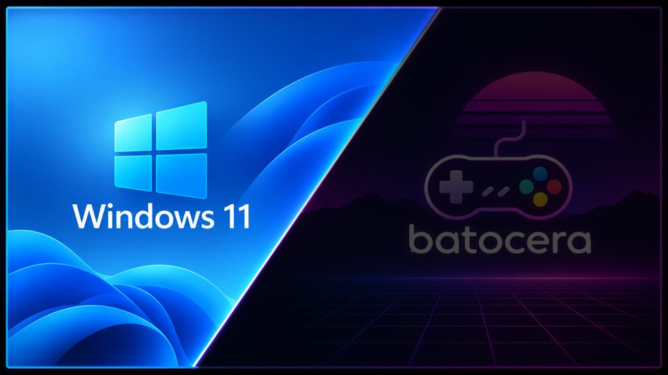
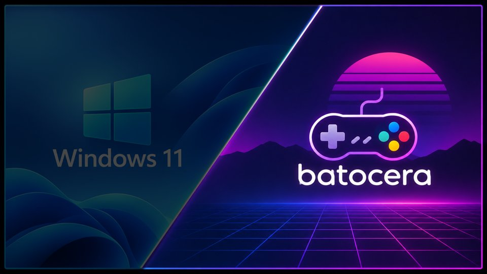

# rEFInd Split Launcher

An experimental **full-screen, two-choice rEFInd menu**: select Windows or
Batocera with the D-pad and the selected half stays bright while the other dims.
This is a **modified rEFInd executable**, not a theme for the stock binary.





## Status

- Reported working on an **ASUS ROG Ally RC71L (Z1 Extreme)**, Windows 11 and
  **Batocera 44**, with Secure Boot disabled.
- Left/right selects; the controller's A button (mapped to Enter) launches.
- Windows left, Batocera right; 1920×1080 artwork with graphics-mode scaling.
- Uses rEFInd's existing OS launching and keyboard-input code.
- Missing images, failed image allocation or an unexpected menu pair fall back
  to the standard menu rather than showing mismatched artwork.
- The included configuration disables mouse/touch and automatic booting.
  Pointer hit-testing follows the diagonal in the code, but pointer support
  has **not** been hardware-tested.
- **Unsigned, experimental, and not supported by ASUS, Microsoft, Batocera or
  upstream rEFInd.** Keep a known-working boot option available.

## Download and installation

Get the test ZIP from [Releases](https://github.com/djblu/refind-split-launcher/releases).
Read [INSTALL.md](INSTALL.md) **before copying any files**. There is deliberately
no automatic firmware installer.

The release does **not** contain a gamepad driver. On the tested Ally setup,
[`UsbXbox360Dxe.efi`](https://github.com/jlobue10/UsbXbox360Dxe) provides the input.
Use the driver you have already verified works, and retain its upstream notices.
Other controllers and handheld models have not been verified by this project.

**Batocera warning:** use its direct `EFI/batocera/grubx64.efi` loader when that is
the verified working path. On the tested installation, launching
`EFI/BOOT/BOOTX64.EFI` triggered **Boot Option Restoration**, rebooted, and changed
the default firmware boot option. The public configuration includes this fix.

## Build on x86-64 Linux

On Ubuntu 24.04:

```sh
sudo apt-get update
sudo apt-get install build-essential binutils gnu-efi python3-pil
make gnuefi
python3 split-tools/test_menu.py
python3 split-tools/package.py
```

The output is `dist/refind-split-launcher.zip`. Its `refind-split` folder contains
the custom binary, sample configuration, icons and generated artwork.
`make gnuefi` also builds upstream's gptsync; that program is not packaged.
Other distributions may need GNU-EFI path overrides; see [BUILDING.txt](BUILDING.txt)
and `Make.common`.

To use your own two-sided image:

```sh
python3 split-tools/package.py --image /path/to/background.png
```

The supplied artwork's diagonal runs from x=1108 at the top to x=482 at the
bottom of a 1672-pixel-wide image. Override `--top` and `--bottom` with fractional
x positions and `--dim` with the unselected brightness (default 0.28):

```sh
python3 split-tools/package.py --image background.png --top 0.66 --bottom 0.29 --dim 0.35
```

The embedded optional pointer hit-test uses the supplied diagonal; changing
artwork geometry does not change that code. Keep pointers disabled unless you
also adapt and test it. Selection changes are immediate, not animated.

## How it works

Changes are in `refind/menu.c`. When the main menu has exactly two row-zero
entries, with `Windows` in the first title and `Batocera` in the second, and
both images are loadable, the renderer paints `split-windows.png` or
`split-batocera.png` instead of standard menu tiles. Existing keyboard selection
and boot dispatch remain in place. Images are cached for the menu lifetime and
freed on exit.

The host-side tests cover the actual image helper functions using mock graphics
allocation/loading, including missing images, scaling failures and cleanup.
They do **not** simulate UEFI, booting an OS or a physical controller. Hardware
feedback is still essential.

## Upstream and licensing

Based on [rEFInd](https://www.rodsbooks.com/refind/) by Roderick W. Smith and
contributors, derived from rEFIt by Christoph Pfisterer.

Upstream source: `https://git.code.sf.net/p/refind/code`  
Baseline commit: `cf542da4459ff18535b0ae3a7910af032834e469`

The baseline is retained in Git history; custom changes are separate.
New split-renderer and packaging/test code is licensed under GPL-3.0-or-later.
Upstream component licences and notices are retained:
see [COPYING.txt](COPYING.txt), [LICENSE.txt](LICENSE.txt) and [CREDITS.txt](CREDITS.txt).
Artwork is supplied by djblu with permission to redistribute; see
[artwork/NOTICE.md](artwork/NOTICE.md). Product names and logos remain the
property of their respective owners; no endorsement is implied.

Please include your handheld model, firmware version, Secure Boot status,
controller-driver version, graphics behaviour and verified loader paths in bug
reports. Do not post passwords, private partition contents or recovery keys.
